# Jumper wire pen

A 3D-printable pen for laying jumper wire on a circuit board, to repair broken traces. Very thin wire
(0.02 to 0.1 mm) comes off a small bought spool inside the pen, runs through the body and leaves through a
bought needle tube at the tip.

All the printed parts come from **one FreeCAD macro**. Every size is a field in a small window that stays
open next to the 3D view, and the model rebuilds a moment after you change a number.

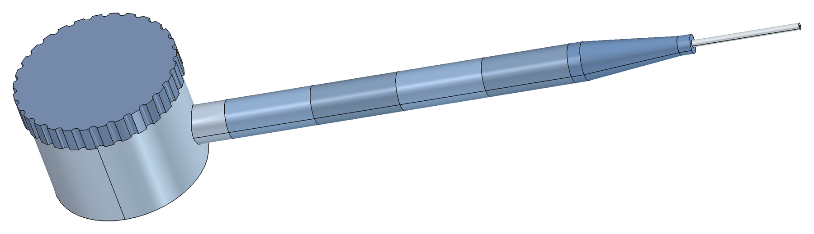

> **Status:** the design has not been test-printed yet. The macro checks in FreeCAD that the parts do not
> overlap (the **Check fit** button reports 0 overlap at the default sizes), but the parts have not yet been printed and
> screwed together. It was written and tried in FreeCAD 1.1 on Windows; other versions are untested.

## The parts

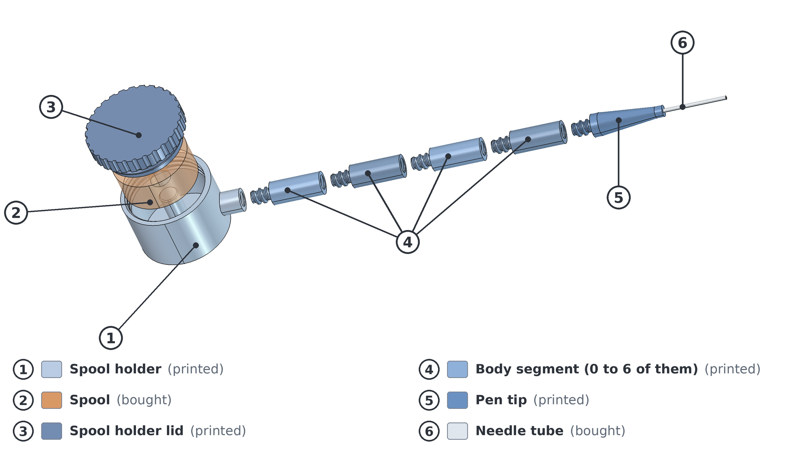

| # | Part | Printed or bought | What it does |
| --- | --- | --- | --- |
| 1 | Spool holder | printed | Round drum at the rear of the pen. The spool lies on its side inside, on a pin, centred on the pen axis. One threaded socket at the front takes the first body segment (or the tip). |
| 2 | Spool | bought | Not printed. The defaults are set for the Donau LD10-MIX spools: 30 mm across, 13 mm wide, centre hole 8 mm. |
| 3 | Spool holder lid | printed | The big round knob on top. It screws on and off by hand. Its hub holds the top end of the pin. Mostly hollow, to save plastic. |
| 4 | Body segment | printed | All segments are identical: a threaded stub at one end, a threaded socket at the other. Use 0 to 6 of them to set the length of the pen. |
| 5 | Pen tip | printed | The tapered nose. It holds the needle tube. |
| 6 | Needle tube | bought | Not printed. The default is 1.6 mm outside diameter, 0.6 mm inside, 25 mm sticking out of the tip. |

The wire leaves the rim of the spool into a funnel, runs along the pen through a 1 mm hole in every part and comes out of the needle tube.
Put together with the default sizes and 4 body segments, the pen is 152 mm long.

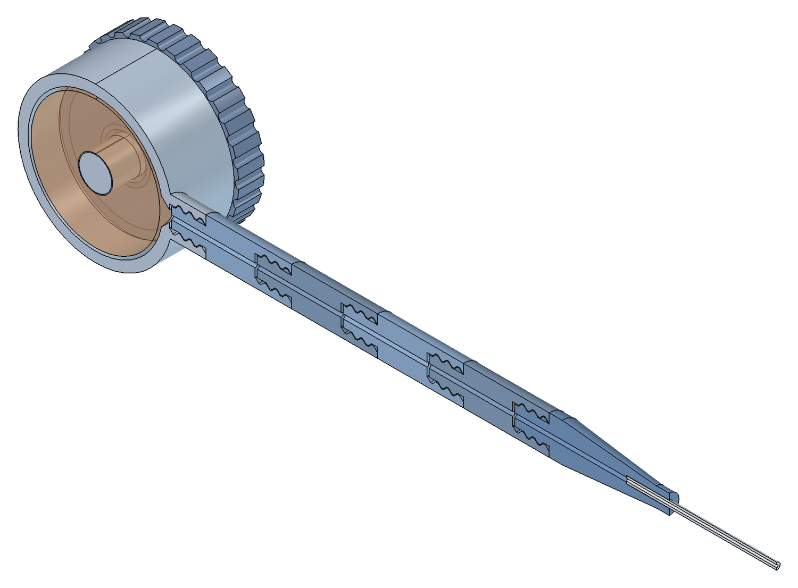

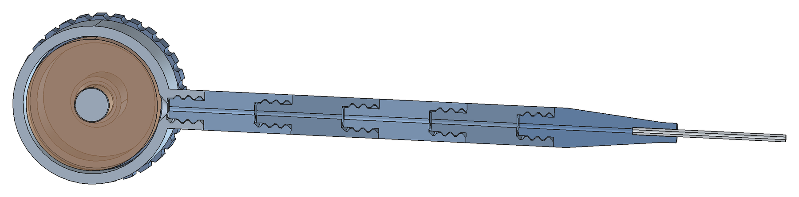

## Install and run

1. Install [FreeCAD](https://www.freecad.org/).
2. Copy `jumper_wire_pen_assembly.FCMacro` into your FreeCAD macro folder (the folder shown in **Macro > Macros...**).
3. Choose **Macro > Macros...**, pick `jumper_wire_pen_assembly`, and press **Execute**.

A window opens and **stays open** while you work, so you can change sizes and watch the 3D view. The macro creates a
document called `JumperWirePen_Assembly` for you. Your last values are remembered. Running the macro again replaces the window.
Close the window when you are done.

## The window

Every setting has a tab. The text under the tabs shows the resulting pen length, the thread numbers, the fit,
and any warnings. If a value makes a part impossible (for example a thread too short for its step), the model keeps its last good shape and the text says why.

Buttons: **Check fit** puts the parts together as they really mate and reports the overlap of every joint (it can take up to a
minute). **Reset sizes** puts all sizes and view options back to their defaults. **Fit view** frames the model. **Close** closes the window.

### Tip shape

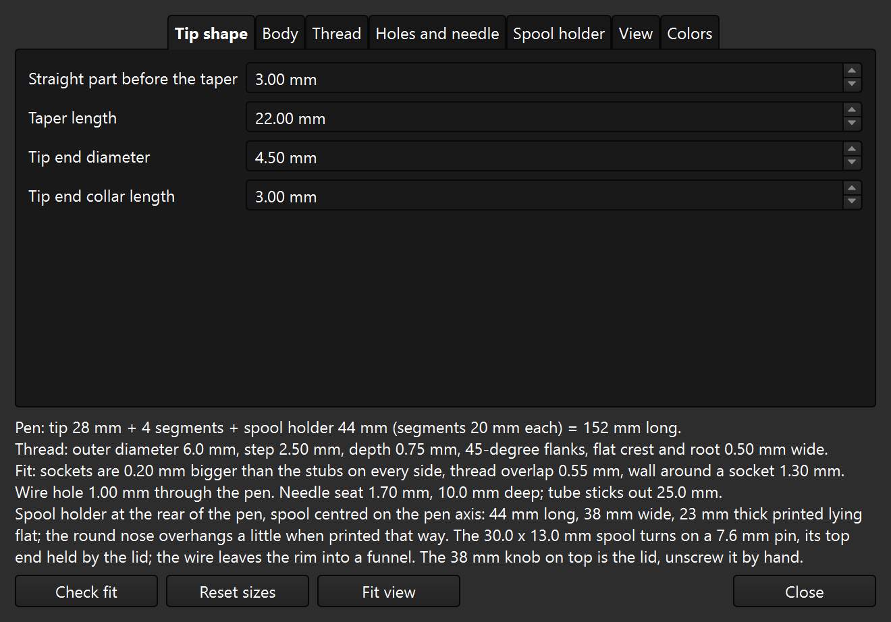

| Setting | Default | Range |
| --- | --- | --- |
| Straight part before the taper | 3 mm | 0.5 to 20 mm |
| Taper length | 22 mm | 5 to 100 mm |
| Tip end diameter | 4.5 mm | 3 to 15 mm |
| Tip end collar length | 3 mm | 1 to 15 mm |

### Body

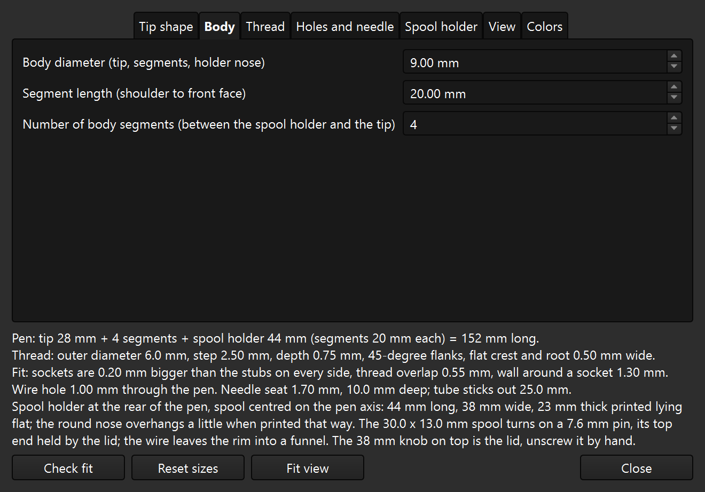

| Setting | Default | Range |
| --- | --- | --- |
| Body diameter (tip, segments, holder nose) | 9 mm | 6 to 30 mm |
| Segment length (shoulder to front face) | 20 mm | 6 to 60 mm |
| Number of body segments (between the spool holder and the tip) | 4 | 0 to 6 |

The body diameter is shared by the tip, the segments and the nose of the spool holder.

### Thread

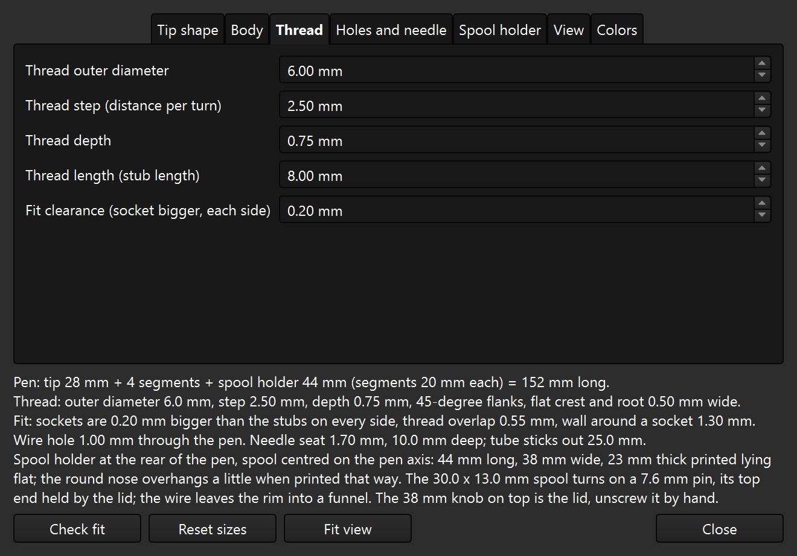

| Setting | Default | Range |
| --- | --- | --- |
| Thread outer diameter | 6 mm | 3 to 28 mm |
| Thread step (distance per turn) | 2.5 mm | 1 to 6 mm |
| Thread depth | 0.75 mm | 0.3 to 2.5 mm |
| Thread length (stub length) | 8 mm | 4 to 24 mm |
| Fit clearance (socket bigger, each side) | 0.2 mm | 0 to 0.6 mm |

The thread is shared by every part, so the parts always fit each other. It is made for FDM printing: a coarse step,
45-degree flanks (no flat overhangs), and flat crests and roots that are wider than one nozzle line (0.50 mm at the defaults).
The sockets are bigger than the stubs by the fit clearance on every side. If the threads bind or wobble on your printer, change that clearance.
If you change any thread setting, reprint all the parts, not just one.

### Holes and needle

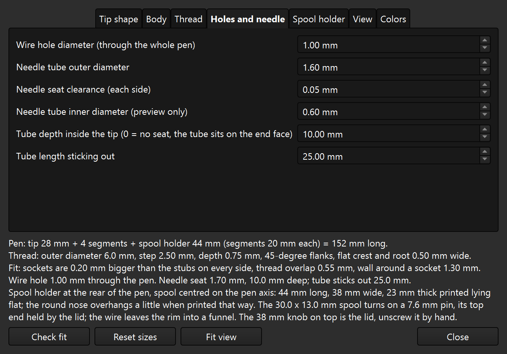

| Setting | Default | Range |
| --- | --- | --- |
| Wire hole diameter (through the whole pen) | 1 mm | 0.3 to 6 mm |
| Needle tube outer diameter | 1.6 mm | 0.6 to 6 mm |
| Needle seat clearance (each side) | 0.05 mm | 0 to 0.5 mm |
| Needle tube inner diameter (preview only) | 0.6 mm | 0.2 to 5 mm |
| Tube depth inside the tip (0 = no seat, the tube sits on the end face) | 10 mm | 0 to 40 mm |
| Tube length sticking out | 25 mm | 5 to 60 mm |

Set the tube depth to 0 for a tip without a seat: the tube then sits on the end face of the tip, and you glue it there.

### Spool holder

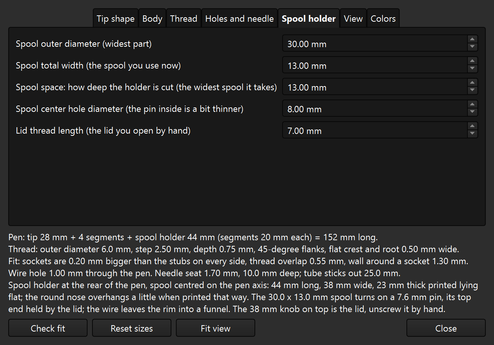

| Setting | Default | Range |
| --- | --- | --- |
| Spool outer diameter (widest part) | 30 mm | 8 to 60 mm |
| Spool total width (the spool you use now) | 13 mm | 2 to 30 mm |
| Spool space: how deep the holder is cut (the widest spool it takes) | 13 mm | 2 to 40 mm |
| Spool center hole diameter (the pin inside is a bit thinner) | 8 mm | 1 to 15 mm |
| Lid thread length (the lid you open by hand) | 7 mm | 3 to 16 mm |

*Spool space* sets how deep the holder is cut, so it decides the widest spool the holder takes. *Spool total width* is the spool you
use now. If your spool is narrower than the space, the text under the tabs tells you how many millimetres of washers or spacers to put
under it to keep it centred on the pen axis.

The defaults are set for the Donau LD10-MIX spools. At these sizes the spool holder is the biggest part of the pen: 44 mm long, 36 mm wide and 23 mm thick, and 38 mm across the lid knob.

The lid has one setting of its own, the lid thread length. The lid thread is sized from the spool diameter, and its step, depth and
clearance are the shared thread settings. The holder length depends on the thread length of the body, because the first body segment
screws into the holder.

### View

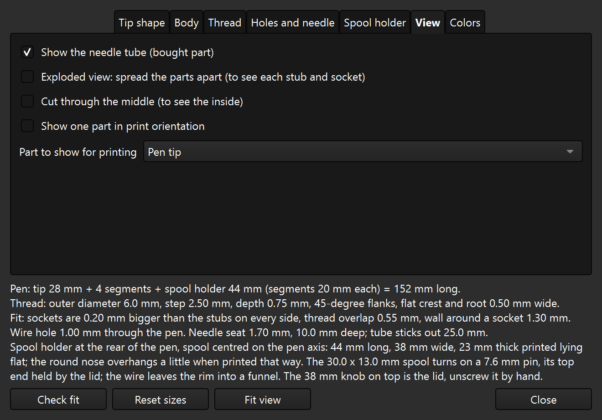

* **Show the needle tube**: shows or hides the bought needle tube.
* **Exploded view**: spreads the parts apart so you can see every stub and socket. The spool and the lid lift clear of the holder. The exploded picture near the top is this view with numbers added.
* **Cut through the middle**: cuts the model in half to show the inside.
* **Show one part in print orientation**: shows only the part chosen in *Part to show for printing*, turned the way it is printed.

### Colors

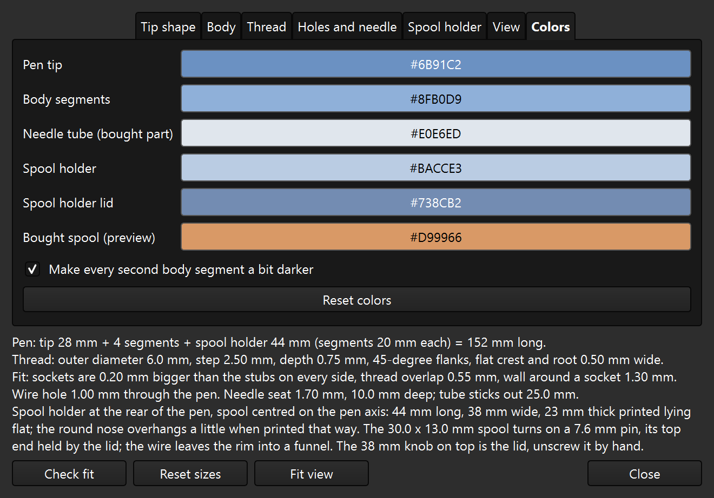

Click a color to change the display color of a part. Optionally every second body segment is drawn a bit darker. **Reset colors** restores the defaults.

## Printing

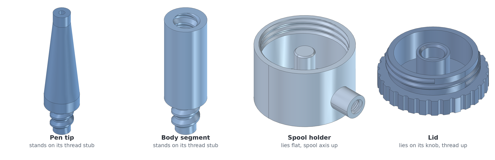

The pictures are not to scale. The pen tip and the body segments stand on their thread stub. The spool holder lies flat with the spool axis pointing up.
The lid lies on its knob with the thread pointing up. Because the holder lies flat, its round nose overhangs a little when printed that way.

To get a file for the slicer at other sizes:

1. In the **View** tab, tick **Show one part in print orientation** and pick the part.
2. Select that part in the FreeCAD model tree.
3. Choose **File > Export...** and save it as an STL file.

Print one tip, one holder, one lid and as many segments as you set in the **Body** tab (4 at the defaults).

## STEP files

The `models/` folder has a STEP file for each printed part, made at the default sizes and turned the way the part is printed (see the picture in the Printing section).

| File | Part | How many to print | Size when printed (mm) |
| --- | --- | --- | --- |
| `models/pen_tip.step` | Pen tip | 1 | 9 x 9 x 36 |
| `models/body_segment.step` | Body segment | 4 | 9 x 9 x 28 |
| `models/spool_holder.step` | Spool holder | 1 | 43.8 x 36.1 x 23.1 |
| `models/spool_holder_lid.step` | Spool holder lid | 1 | 38.1 x 38.1 x 13.3 |

Many slicers (PrusaSlicer, for example) open STEP files directly; for other slicers, convert the file to STL. These files only fit the default sizes. For other sizes, run the macro and export the parts as described above.

## Shopping list

* Needle tube (default 1.6 mm outside diameter, 0.6 mm inside; change the sizes in the **Holes and needle** tab if yours differ).
* A spool of very thin enamelled wire (0.02 to 0.1 mm). The defaults are set for the Donau LD10-MIX set (seven spools of 0.10 mm wire, 10 m each): 30 mm across, 13 mm wide, centre hole 8 mm. Measure your own spool with calipers and set its sizes in the **Spool holder** tab if it differs.
* Optional: washers or spacers for a spool that is narrower than the spool space.

## Known limits

* Not test-printed yet (see the status note at the top).
* The holder length follows the body thread length, because the first segment screws into the holder.
* A spool narrower than the spool space needs washers or spacers to stay centred.
* The round nose of the holder overhangs a little when the holder is printed flat.

## Files

| File | What it is |
| --- | --- |
| `jumper_wire_pen_assembly.FCMacro` | The macro. It is the only file you need to build the pen. |
| `models/` | STEP files of the four printed parts at the default sizes. |
| `images/` | The pictures used in this README. |
| `LICENSE` | The MIT license. |

## License

MIT License. See [LICENSE](LICENSE).
